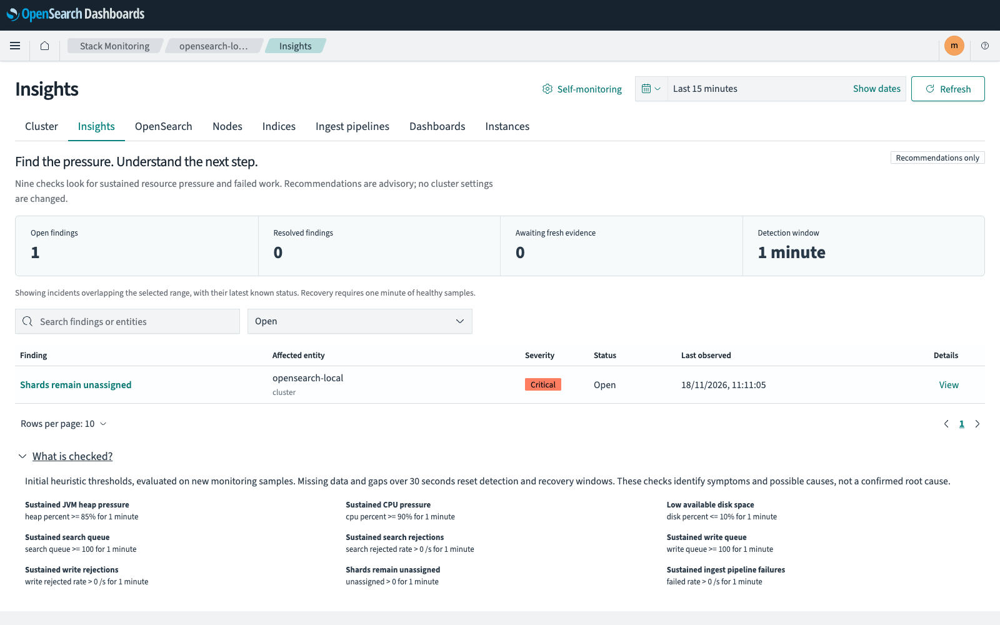

# Stack Monitoring for OpenSearch Dashboards

See how your OpenSearch cluster is doing—and where to investigate next—without leaving Dashboards.

[](https://github.com/deveshk0/opensearch-stack-monitoring/actions/workflows/ci.yml)
[](https://github.com/deveshk0/opensearch-stack-monitoring/releases/latest)
[](LICENSE)
[](docs/installation.md)

**[Install](#install) · [Try locally](#try-it-locally) · [Documentation](#documentation) · [Contribute](CONTRIBUTING.md)**


An independent community plugin for **OpenSearch Dashboards 3.9.0**. This project is not an official OpenSearch release or affiliated with Elastic.

## What you can do

- **Check cluster health at a glance.** See nodes, indices, shards, JVM heap, storage, and Dashboards traffic in one place.
- **Drill into a problem.** Explore node and index charts, shard allocation and recovery, ingest pipelines, and individual processors.
- **Review operational insights.** Nine checks surface sustained heap, CPU, disk, queue, rejection, shard, and pipeline issues with evidence and suggested next steps.
- **Keep monitoring history.** Collect every ten seconds in the background. Enable or disable self-monitoring from the UI without deleting history.
- **Manage storage automatically.** Monitoring indices use templates, a write alias, ISM rollover, and retention. Resolved insights have their own cleanup policy.
- **Control access.** Separate collector, reader, and manager roles; collector credentials stay on the server.

<details>
<summary>See operational insights</summary>



This screenshot comes from a controlled test. Insights suggest investigations; they do not automatically change cluster settings or send notifications.

</details>

## Install

| Requirement | Supported setup |
| --- | --- |
| OpenSearch / OpenSearch Dashboards | **3.9.0**; other versions are not verified |
| Collection | One attached cluster, one collecting Dashboards instance |
| Storage and access | OpenSearch Security and Index Management; provision monitoring resources and roles |

Download the ZIP and checksum from the **[latest release](https://github.com/deveshk0/opensearch-stack-monitoring/releases/latest)**:

```sh
curl -fLO https://github.com/deveshk0/opensearch-stack-monitoring/releases/latest/download/stack-monitoring.zip
curl -fLO https://github.com/deveshk0/opensearch-stack-monitoring/releases/latest/download/SHA256SUMS
shasum -a 256 -c SHA256SUMS
```

Then follow the **[installation guide](docs/installation.md)** to provision storage and roles, install the ZIP, and configure the collector. Once configured, open **Stack Monitoring** from the Dashboards navigation and enable **Self-monitoring** with a monitoring manager account.

For upgrades, use a specific release tag, keep your configuration and data directory, and follow the [upgrade instructions](docs/installation.md#install-a-release). Plugin release versions and Dashboards compatibility are separate: a plugin release such as `v1.1.0` still requires the host version stated in its release notes.

## Try it locally

The demo starts **three OpenSearch nodes and Dashboards** with the plugin, monitoring roles, and local credentials configured.

You need Docker with Compose, Git, curl, Python 3, and macOS or Linux. Allow about **6 GB for the running stack**, plus memory for the dependency build (Node permits an 8 GB heap). Ports **5602** and **9201** must be available. The first build downloads the official Dashboards source and dependencies.

```sh
git clone https://github.com/deveshk0/opensearch-stack-monitoring.git
cd opensearch-stack-monitoring
bash scripts/bootstrap.sh
bash scripts/start-local.sh
```

1. Open **http://localhost:5602/app/stackMonitoring**.
2. Sign in as **`monitor`**. Find its password under `MONITORING_READER_PASSWORD` in the generated `.opensearch.env` file.
3. Select the **Global** tenant if prompted. Wait for the first samples; charts need consecutive samples before showing rates.

The demo uses demo certificates and unverified TLS on loopback. Keep it local and keep `.opensearch.env` private. For an existing cluster, use the [verified-TLS installation guide](docs/installation.md).

Stop the demo while keeping its data:

```sh
docker compose --env-file .opensearch.env -f compose.opensearch.yml stop
```

## Documentation

| Guide | What you will find |
| --- | --- |
| [Installation and operations](docs/installation.md) | Releases, upgrades, TLS, roles, collector ownership, rollover, retention, and recovery |
| [Self-monitoring](docs/self-monitoring.md) | Enable collection, view its status, and understand stored history |
| [Operational insights](docs/insights.md) | Checks, thresholds, evidence, and incident lifecycle |
| [Contributing](CONTRIBUTING.md) | Build from source, run tests, and write semantic commits |
| [Readiness and limits](docs/production-readiness.md) | Verified behavior and remaining deployment constraints |

## Releases and project status

Successful updates to `main` automatically publish a GitHub release after tests, the official plugin build, and type-checking pass. Releases include the installable ZIP, SHA-256 checksum, and generated change notes. `feat:` commits increment the minor version; breaking changes increment the major version; other updates increment the patch version. See [release details](CONTRIBUTING.md#releases).

The plugin supports one collecting instance and a maximum chart window of 24 hours. It does not provide automatic collector failover, remote-cluster enrollment, log shipping, or alert delivery. Optional logs require an existing log index. Validate workload capacity, permissions, and recovery in staging; complete cluster outages need independent monitoring.

## Get involved

[Report a bug or suggest an improvement](https://github.com/deveshk0/opensearch-stack-monitoring/issues), or read [CONTRIBUTING.md](CONTRIBUTING.md) to submit a pull request. Include your host version and reproduction steps, and remove credentials and private data from logs.

For vulnerabilities, follow [SECURITY.md](SECURITY.md) instead of opening a public issue.

Licensed under [Apache 2.0](LICENSE). See [NOTICE](NOTICE) for attribution; dependencies supplied by Dashboards retain their own licenses.
