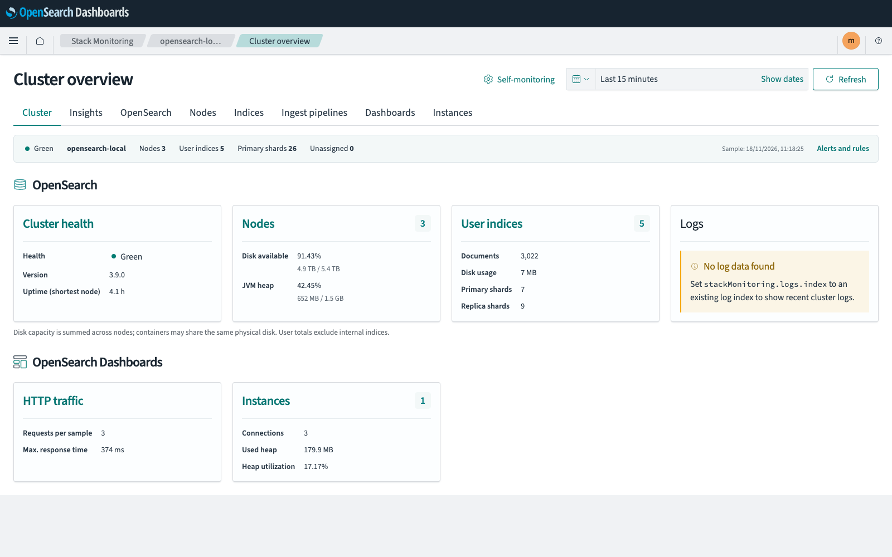

# Stack Monitoring for OpenSearch Dashboards

See how your OpenSearch cluster is doing—and where to investigate next—without leaving Dashboards.

[](https://github.com/deveshk0/opensearch-stack-monitoring/actions/workflows/ci.yml)
[](https://github.com/deveshk0/opensearch-stack-monitoring/releases/latest)
[](LICENSE)
[](docs/installation.md)

**[Install](#install) · [Try locally](#try-it-locally) · [Documentation](#documentation) · [Contribute](CONTRIBUTING.md)**



An independent community plugin for **OpenSearch Dashboards 3.9.0**. This project is not an official OpenSearch release or affiliated with Elastic.

## What you can do

- **Check cluster health at a glance.** See nodes, indices, shards, JVM heap, storage, and Dashboards traffic in one place.
- **Drill into a problem.** Explore node and index charts, shard allocation and recovery, ingest pipelines, and individual processors.
- **Review operational insights.** Nine checks surface sustained heap, CPU, disk, queue, rejection, shard, and pipeline issues with evidence and suggested next steps.
- **Keep monitoring history.** Collect every ten seconds in the background. Enable or disable self-monitoring from the UI without deleting history.
- **Manage storage automatically.** Monitoring indices use templates, a write alias, ISM rollover, and retention. Resolved insights have their own cleanup policy.
- **Control access.** Separate collector, reader, and manager roles; collector credentials stay on the server.

<details>
<summary>See operational insights</summary>


This screenshot comes from a controlled test. Insights suggest investigations; they do not automatically change cluster settings or send notifications.

</details>

## Install

These steps add the plugin to an **existing, working OpenSearch and Dashboards installation**. For a new local cluster, use [Try it locally](#try-it-locally). Install this ZIP in **Dashboards**, not on the OpenSearch nodes.

| Requirement | Supported setup |
| --- | --- |
| OpenSearch / OpenSearch Dashboards | **3.9.0**; other versions are not verified |
| Collection | One attached cluster, one collecting Dashboards instance |
| OpenSearch plugins | Security and Index Management enabled |
| Operator access | An identity authorized to manage monitoring indices, templates, ISM policies, and Security roles |
| Setup tools | Git, curl, Python 3, and `shasum` (or `sha256sum` on Linux) |
| Connectivity | Verified HTTPS access to OpenSearch; the cluster CA certificate if privately signed |

**[Download](#1-download-and-verify) → [Provision](#2-provision-monitoring-storage) → [Assign access](#3-create-the-collector-account-and-map-roles) → [Install](#4-install-the-plugin) → [Configure](#5-configure-collection) → [Verify](#6-start-dashboards-and-verify)**

### 1. Download and verify

Choose a tag from [Releases](https://github.com/deveshk0/opensearch-stack-monitoring/releases). The example pins `v1.0.0`; replace it with your chosen release. Use a fresh working directory and the same terminal for the commands below. Checking out the matching source provides the provisioner and Dockerfile; **you do not need Node or a source build to install a release**.

```sh
release_tag=v1.0.0
git clone --depth 1 --branch "$release_tag" \
  https://github.com/deveshk0/opensearch-stack-monitoring.git
cd opensearch-stack-monitoring
monitoring_checkout="$PWD"
mkdir -p artifacts

curl -fL "https://github.com/deveshk0/opensearch-stack-monitoring/releases/download/$release_tag/stack-monitoring.zip" \
  -o artifacts/stack-monitoring.zip
curl -fL "https://github.com/deveshk0/opensearch-stack-monitoring/releases/download/$release_tag/SHA256SUMS" \
  -o artifacts/SHA256SUMS
(cd artifacts && shasum -a 256 -c SHA256SUMS)
plugin_zip="$PWD/artifacts/stack-monitoring.zip"
```

Continue only if verification reports **`stack-monitoring.zip: OK`**. On Linux, `sha256sum -c SHA256SUMS` is an alternative. Plugin release versions and host compatibility are separate: a release such as `v1.1.0` still requires the Dashboards version stated in its release notes.

### 2. Provision monitoring storage

From the checked-out repository, run the provisioner against your cluster. Replace the endpoint, CA path, and provisioning username:

```sh
python3 scripts/provision-monitoring.py \
  --url https://cluster.example:9200 \
  --ca-cert /path/to/root-ca.pem \
  --username provisioning-admin \
  --retention-days 7 \
  --replicas 1
```

Enter the provisioning account's password at the prompt. Omit `--ca-cert` when your certificate is trusted by the system CA store. For unattended use, inject `OPENSEARCH_PASSWORD` through your secret manager; do not put passwords in command arguments.

The script creates monitoring roles, templates, the `stack-monitoring-write` alias and backing index, settings/ownership/insight indices, and an ISM policy. Metrics roll over at one day or 20 GiB primary storage; rolled indices become eligible for deletion seven days later. One replica requires at least two data nodes for green monitoring indices; a single-node evaluation can use `--replicas 0`.

Provisioning preserves an existing self-monitoring choice and does **not** create users or role mappings. It updates named monitoring resources, so review retention changes before rerunning it on an installation with history. Keep provisioning privileges separate from the collector account used below.

### 3. Create the collector account and map roles

While Dashboards is still running, sign in as a Security administrator:

1. Open **Security → Internal users → Create internal user**. Create a dedicated account named `stack_monitoring_collector` with a strong password kept in your secret manager. An existing dedicated identity with username/password authentication can also be used.
2. Open **Security → Roles → stack_monitoring_collector → Mapped users → Manage mapping**. Add that account and save, preserving any existing mappings.
3. Map your human users or identity-provider backend roles as follows:

| Identity | Monitoring roles | Purpose |
| --- | --- | --- |
| Dedicated collector account | `stack_monitoring_collector` | Read statistics and write monitoring data; used only by the Dashboards server |
| Human viewer | `stack_monitoring_reader` | Read metrics, history, and insights |
| Human monitoring operator | `stack_monitoring_reader` **and** `stack_monitoring_manager` | Read monitoring data and toggle self-monitoring |

Human users also need your deployment's usual Dashboards sign-in permissions (for example, `kibana_user`) and access to the **Global** tenant. The reader role includes Global-tenant read access. The manager role alone does not grant read or sign-in access. Keep your existing Dashboards server identity and its roles unchanged; the collector is a separate account. See the [OpenSearch role-mapping guide](https://docs.opensearch.org/3.9/security/access-control/users-roles/) for external identity providers.

### 4. Install the plugin

Choose the option matching your Dashboards deployment. Preserve its configuration and data directory before changes.

**Debian/RPM package with systemd**

The commands below use the standard package installation directory. Stop Dashboards, install the verified local ZIP, and confirm the plugin appears:

```sh
sudo systemctl stop opensearch-dashboards
cd /usr/share/opensearch-dashboards
sudo bin/opensearch-dashboards-plugin install "file://${plugin_zip}" --allow-root
sudo bin/opensearch-dashboards-plugin list --allow-root
```

The list should include **`stackMonitoring@<release-version>`**. Keep the service stopped until step 5 is complete. For tarball installations, stop your managed process and run the same plugin commands from its installation directory **as the installation owner**, without `sudo` or `--allow-root`. These commands follow the [official plugin-manager instructions](https://docs.opensearch.org/3.9/install-and-configure/install-dashboards/plugins/).

<details>
<summary><strong>Docker: build a Dashboards image containing the release ZIP</strong></summary>

From the matching repository checkout, with the verified ZIP in `artifacts/`:

```sh
cd "$monitoring_checkout"
docker build -f docker/Dockerfile.dashboards \
  --build-arg OPENSEARCH_VERSION=3.9.0 \
  -t "local/stack-monitoring-dashboards:$release_tag" .
```

Use this image for your **existing Dashboards service**. Keep its OpenSearch connection settings, network, certificates, and server credentials. Mount your configured `opensearch_dashboards.yml` at `/usr/share/opensearch-dashboards/config/opensearch_dashboards.yml`, inject `MONITORING_COLLECTOR_PASSWORD` into the container, and retain a persistent volume at `/usr/share/opensearch-dashboards/data`.

The supplied Dockerfile installs the plugin and gives browser assets an archive-specific build identity. Rebuild the image for each plugin upgrade; installing into a running container is not persistent. The repository's Compose configuration and `docker/opensearch_dashboards.yml` are for the local demo, with unverified TLS; use your existing secured configuration for an external cluster.

After completing step 5, update the image reference in your own Compose file and recreate the Dashboards service (replace `dashboards` if your service has another name):

```sh
docker compose up -d --no-deps dashboards
docker compose logs --tail=100 dashboards
```

</details>

### 5. Configure collection

Add these settings to your existing `opensearch_dashboards.yml`: normally `/etc/opensearch-dashboards/opensearch_dashboards.yml` for packages, or `config/opensearch_dashboards.yml` under a tarball/container installation. Use the dedicated account from step 3:

```yaml
stackMonitoring.collection.enabled: true
stackMonitoring.collection.username: stack_monitoring_collector
stackMonitoring.collection.password: "${MONITORING_COLLECTOR_PASSWORD}"
stackMonitoring.collection.resolvedRetentionDays: 30
# Optional: show logs from an existing index; this does not install a log shipper.
# stackMonitoring.logs.index: cluster-logs-*
```

The plugin inherits the host's OpenSearch connection and TLS configuration. Keep certificate verification enabled (`opensearch.ssl.verificationMode: full`) and configure `opensearch.ssl.certificateAuthorities` for a private CA. Preserve the existing `opensearch.username` / `opensearch.password` server credentials. Browser access should use HTTPS, directly or through your secured proxy. Optional log access also requires the signed-in user's read permission on that index.

Supply `MONITORING_COLLECTOR_PASSWORD` to the **Dashboards process**, not just your interactive shell. For a systemd package installation:

1. Create `/etc/opensearch-dashboards/stack-monitoring.env` as a root-owned file with mode `0600`, containing the dedicated account's password:

   ```text
   MONITORING_COLLECTOR_PASSWORD=replace-with-the-collector-password
   ```

   Use systemd EnvironmentFile quoting when the password includes whitespace or special characters. Keep this file out of Git.
2. Run `sudo systemctl edit opensearch-dashboards` and add:

   ```ini
   [Service]
   EnvironmentFile=/etc/opensearch-dashboards/stack-monitoring.env
   ```

3. Save the override and run `sudo systemctl daemon-reload`.

For Docker, inject the environment variable through your deployment's secret mechanism. For a tarball, provide it through the process manager that starts Dashboards.

Enable collection on **one instance only**. Set `stackMonitoring.collection.enabled: false` on any other Dashboards instances attached to this cluster. Persist the collecting instance's data directory so its UUID survives restarts; never share or clone that directory between active instances.

### 6. Start Dashboards and verify

For systemd packages:

```sh
sudo systemctl start opensearch-dashboards
sudo systemctl status opensearch-dashboards --no-pager
sudo journalctl -u opensearch-dashboards -n 100 --no-pager
```

For Docker or tarballs, start/recreate the service using its normal process manager.

1. Sign in as a monitoring operator from step 3 and choose the **Global** tenant.
2. Open **Stack Monitoring** from the navigation, or visit `/app/stackMonitoring` under your Dashboards URL (including any configured base path).
3. Open **Self-monitoring** beside the date picker. Confirm collection is enabled, or enable it. Fresh provisioning enables the persisted setting; rerunning provisioning preserves the previous choice.
4. Allow at least two ten-second samples. Confirm the last-success time advances, nodes and indices appear, and charts start showing rates. Choose **Last 15 minutes** when checking fresh data.
5. Sign in as a viewer to check that metrics are readable and the self-monitoring setting cannot be changed. Healthy clusters can have an empty Insights view; a sustained breach needs at least 60 seconds before an insight appears.

In Dashboards **Dev Tools**, an authorized operator can inspect storage without changing it:

```http
GET /_cat/aliases/stack-monitoring-write?v
GET /_cat/indices/stack-monitoring-v2-*?v
GET /_plugins/_ism/explain/stack-monitoring-v2-*?show_policy=true
```

Expect a write alias, monitoring backing indices, and the attached `stack-monitoring-v2-retention` policy. Normal monitoring readers may not have ISM administration permissions.

### Upgrade or remove

To upgrade, choose a new release tag and repeat the matching-source download and checksum verification in a fresh working directory. Read its release notes and preserve your configuration, data directory, and monitoring backups. Rerun the matching provisioner if that release changes monitoring roles or storage resources.

For a package installation, stop Dashboards, remove the old plugin code, and install the new verified ZIP:

```sh
sudo systemctl stop opensearch-dashboards
cd /usr/share/opensearch-dashboards
sudo bin/opensearch-dashboards-plugin remove stackMonitoring --allow-root
sudo bin/opensearch-dashboards-plugin install "file://${plugin_zip}" --allow-root
sudo systemctl start opensearch-dashboards
```

Tarball owners use the same plugin commands without `sudo` / `--allow-root`. Docker deployments rebuild and replace the image. Confirm the installed version, fresh monitoring samples, and updated browser assets after every upgrade. If your proxy or browser serves old plugin assets, invalidate those cached assets; the supplied Docker image changes the asset build identity automatically.

To uninstall, first disable self-monitoring and stop the collecting instance, then remove the plugin (or deploy an image without it). Remove `stackMonitoring.*` configuration entries before restarting Dashboards. Plugin removal leaves monitoring indices in place; the existing ISM policy can still expire metrics, while plugin-driven incident cleanup stops. Follow [ownership recovery](docs/installation.md#ownership-and-recovery) before moving collection to a different instance.

### Installation troubleshooting

| Symptom | Check |
| --- | --- |
| Installer rejects compatibility | Use Dashboards **3.9.0** and the release's plugin ZIP, not GitHub's source ZIP. |
| Dashboards cannot resolve `MONITORING_COLLECTOR_PASSWORD` | Provide the variable to the service/container and restart it; an export in your shell does not configure systemd. |
| `401` / `403` during collection | Verify the dedicated account's credentials and its `stack_monitoring_collector` mapping. Recheck the provisioner output. |
| `403` while viewing or toggling collection | Viewers need reader and Dashboards access; toggling additionally needs the manager role. |
| No monitoring data | Check both collection switches, last-success/error status, the time range, and Dashboards logs. Confirm provisioning completed. |
| Another collector owns the cluster | Stop the former collector and use the documented [ownership recovery](docs/installation.md#ownership-and-recovery); do not delete the lock while it can still collect. |
| Certificate/hostname error | Use the correct HTTPS endpoint and trusted CA, and verify certificate names. Keep TLS verification enabled. |
| Monitoring indices are yellow | Ensure enough data nodes can host the configured replicas; inspect allocation before changing settings. |

For storage lifecycle details and operational recovery, see [Installation and operations](docs/installation.md).

## Try it locally

The demo starts **three OpenSearch nodes and Dashboards** with the plugin, monitoring roles, and local credentials configured.

You need Docker with Compose, Git, curl, Python 3, and macOS or Linux. Allow about **6 GB for the running stack**, plus memory for the dependency build (Node permits an 8 GB heap). Ports **5602** and **9201** must be available. The first build downloads the official Dashboards source and dependencies.

```sh
git clone https://github.com/deveshk0/opensearch-stack-monitoring.git
cd opensearch-stack-monitoring
bash scripts/bootstrap.sh
bash scripts/start-local.sh
```

1. Open **http://localhost:5602/app/stackMonitoring**.
2. Sign in as **`monitor`**. Find its password under `MONITORING_READER_PASSWORD` in the generated `.opensearch.env` file.
3. Select the **Global** tenant if prompted. Wait for the first samples; charts need consecutive samples before showing rates.

The demo uses demo certificates and unverified TLS on loopback. Keep it local and keep `.opensearch.env` private. For an existing cluster, use the [verified-TLS installation guide](docs/installation.md).

Stop the demo while keeping its data:

```sh
docker compose --env-file .opensearch.env -f compose.opensearch.yml stop
```

## Documentation

| Guide | What you will find |
| --- | --- |
| [Installation and operations](docs/installation.md) | Releases, upgrades, TLS, roles, collector ownership, rollover, retention, and recovery |
| [Self-monitoring](docs/self-monitoring.md) | Enable collection, view its status, and understand stored history |
| [Operational insights](docs/insights.md) | Checks, thresholds, evidence, and incident lifecycle |
| [Contributing](CONTRIBUTING.md) | Build from source, run tests, and write semantic commits |
| [Readiness and limits](docs/production-readiness.md) | Verified behavior and remaining deployment constraints |

## Releases and project status

Successful updates to `main` automatically publish a GitHub release after tests, the official plugin build, and type-checking pass. Releases include the installable ZIP, SHA-256 checksum, and generated change notes. `feat:` commits increment the minor version; breaking changes increment the major version; other updates increment the patch version. See [release details](CONTRIBUTING.md#releases).

The plugin supports one collecting instance and a maximum chart window of 24 hours. It does not provide automatic collector failover, remote-cluster enrollment, log shipping, or alert delivery. Optional logs require an existing log index. Validate workload capacity, permissions, and recovery in staging; complete cluster outages need independent monitoring.

## Get involved

[Report a bug or suggest an improvement](https://github.com/deveshk0/opensearch-stack-monitoring/issues), or read [CONTRIBUTING.md](CONTRIBUTING.md) to submit a pull request. Include your host version and reproduction steps, and remove credentials and private data from logs.

For vulnerabilities, follow [SECURITY.md](SECURITY.md) instead of opening a public issue.

Licensed under [Apache 2.0](LICENSE). See [NOTICE](NOTICE) for attribution; dependencies supplied by Dashboards retain their own licenses.
